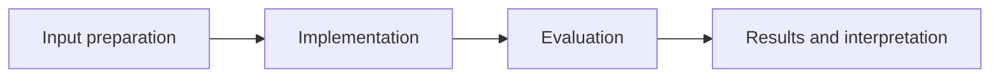

# Wine Quality Statistical Analysis

**Feras Elghandour** · Technical case study

Quantify differences in measured properties across expert-rated quality groups while distinguishing association, effect size, and statistical uncertainty.

## Implementation

Descriptive analysis, wine-type stratification, correlation plots, directional Welch testing, an explicitly named standardized effect size, and a Welch confidence interval.



## Evidence and results

The saved dataset combines 6,497 red and white wines. High-quality wines (rating ≥7) average about 1.560 alcohol percentage points above low-quality wines (rating ≤5). Corrected directional testing and interval calculations are included in the executable notebook.

Results described as saved come from the retained experiment record. See [VALIDATION.md](VALIDATION.md) for the checks performed on this release and their scope.

## Fresh reproduction — October 17, 2026

Fresh execution reports a high-minus-low alcohol difference of 1.5598 percentage points, Welch 95% CI [1.4850, 1.6346], and pooled-SD Cohen’s d of 1.5782. The directional Welch p-value is approximately 8.68×10⁻²⁶⁵.

The environment versions, input hashes, and notebook hash are recorded in [results/reproduction.json](results/reproduction.json).


## Practical relevance

This project demonstrates descriptive analysis, wine-type stratification, correlation plots, directional Welch testing, an explicitly named standardized effect size, and a Welch confidence interval.
The implementation and evaluation make the trade-offs inspectable for technical review.

## Run locally

```sh
python -m venv .venv
source .venv/bin/activate
python -m pip install -r requirements.txt
jupyter lab analysis.ipynb
```

Prepare the inputs described in [DATA.md](DATA.md) first. Source validation is available without installing model dependencies:

```sh
python scripts/validate_source.py
```

## Limitations

The comparison is observational and pooled across wine types. It does not show that increasing alcohol causes a higher rating. Repeated exploratory comparisons and dataset sampling limit generalization.

## Development

Changes should include a clear description of the behavior affected and verification appropriate to that behavior. Keep input data, credentials, model caches, and generated artifacts outside version control.
