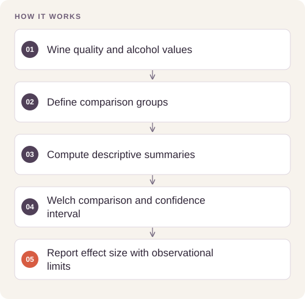
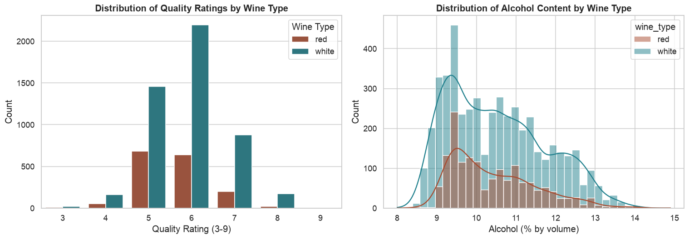

# Wine Quality Statistical Analysis

Quantify differences in measured properties across expert-rated quality groups while distinguishing association, effect size, and statistical uncertainty.

## Implementation

Descriptive analysis, wine-type stratification, correlation plots, directional Welch testing, an explicitly named standardized effect size, and a Welch confidence interval.




## Reproduce the statistical contrast

The full retained analysis has been rerun against the real 6,497-row wine table, with exact source/input hashes and captured outputs.

[Commands, artifacts and benchmark scope](BENCHMARKS.md) · [Versioned profiles](reproduction.json)


## Try a small example

A small offline fixture exercises the public implementation. It demonstrates the behavior shown below; it does not replace the historical dataset, benchmark or production validation.

After the local setup below, run from the repository root:

```sh
python examples/quickstart.py
```

The [example source](examples/quickstart.py), [captured output](examples/expected-output.txt) and [execution record](examples/environment.json) keep this demonstration inspectable. Floating-point values may vary with library versions.

Observed output from this run:

```text
{
  "fixture": "eight generated wine records, not historical inference",
  "difference": 2.0,
  "ci95": [
    1.2474668565296883,
    2.7525331434703117
  ],
  "cohens_d": 4.598409991436083,
  "p_one_sided": 0.00031480046849592126
}
```

## Evidence and results

The saved dataset combines 6,497 red and white wines. High-quality wines (rating ≥7) average about 1.560 alcohol percentage points above low-quality wines (rating ≤5). Corrected directional testing and interval calculations are included in the executable notebook.

See [VALIDATION.md](VALIDATION.md) for the release checks and their scope.

## Fresh reproduction — October 17, 2026

Fresh execution reports a high-minus-low alcohol difference of 1.5598 percentage points, Welch 95% CI [1.4850, 1.6346], and pooled-SD Cohen’s d of 1.5782. The directional Welch p-value is approximately 8.68×10⁻²⁶⁵.

The environment versions, input hashes, and notebook hash are recorded in [results/reproduction.json](results/reproduction.json).



## Run locally

```sh
python -m venv .venv
source .venv/bin/activate
python -m pip install -r requirements.txt
jupyter lab analysis.ipynb
```

Prepare the inputs described in [DATA.md](DATA.md) first. Source validation is available without installing model dependencies:

```sh
python scripts/validate_source.py
```

## Limitations

The comparison is observational and pooled across wine types. It does not show that increasing alcohol causes a higher rating. Repeated exploratory comparisons and dataset sampling limit generalization.
